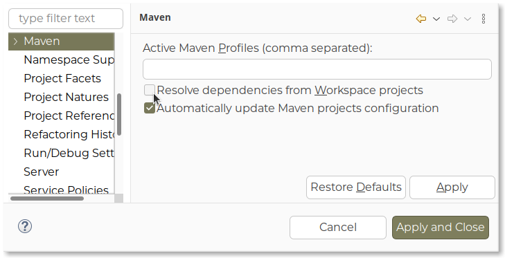

students-dao-service
===
###  A1 - Servlets in Java

Backend service that gives an EJB component for `students-java`
It uses `students-inmemory-dao` to simulate a dao

Notes:
---
- Execute `maven install` to add the jar to the maven repository
- **Do not deploy this project**

REMEMBER THIS!!
---
**We must uncheck Maven dependency resolution from workspace projects**
- Right-click on Project: Properties -> Maven -> [] Resolve dependencies from Workspace projects (uncheck)

